  

  <strong>AI/ML researcher</strong> · PhD candidate · neuro-symbolic AI, 3D digital twins, speech interfaces

  <a href="mailto:valiev.dilmurod1998@gmail.com">Email</a> ·
  <a href="https://dilmurod777.github.io">Website</a> ·
  <a href="https://github.com/Dilmurod777">GitHub</a> ·
  <a href="https://linkedin.com/in/dilmurod-valiev">LinkedIn</a> ·
  <a href="https://dilmurod777.github.io/resume.pdf">CV</a>

## What I build

Speech → symbolic command → deterministic gate → 3D twin. The gate checks twin state, procedure and intent, and refuses unsafe actions with a reason. I also build the web and mobile surfaces around it.

## Selected work

| Project | What it does | Numbers |
|---|---|---|
| **[voice-to-twin-gate](https://github.com/Dilmurod777/voice-to-twin-gate)** [live demo](https://voice-to-twin-gate.vercel.app) FastAPI · Ollama · Three.js | Spoken command becomes a checked action on a 3D twin. | `0/13` unsafe `44` tests |
| **[manual-rag-evals](https://github.com/Dilmurod777/manual-rag-evals)** FastAPI · Ollama · NumPy | Three retrievers over FAA AC 43.13-1B, scored on 60 checked questions. | `60/60` gold pages `55/60` cited `17` tests |
| **[llm-serving-bench](https://github.com/Dilmurod777/llm-serving-bench)** vLLM · llama.cpp · Ollama | Ollama vs llama.cpp vs vLLM on one RTX 5090, 200 fixed prompts. | `1646 tok/s` `$0.06/1M` `51` tests |

## Experience

- **AI/ML researcher · Inha University AI Lab** · `2021 — now`  
  Speech-to-symbolic pipeline for aircraft-maintenance training on HoloLens. The action sandbox cut unsafe actions from `11.8%` to `0.7%`.
- **Full-stack developer · Designmodo** · `2021 — 2022` · remote  
  React editor, SlateJS, Laravel queues. `52%` faster previews; `24%` less image storage.

## Education

- **Integrated MS/PhD · Inha University** · `2021 — now` · CGPA `4.20/4.5`
- **BSc · Inha University in Tashkent** · `2016 — 2020` · First of 270 · `4.48/4.5`

## Publication

Siyaev, A.; **Valiev, D.**; Jo, G.-S. **Interaction with Industrial Digital Twin Using Neuro-Symbolic Reasoning.** *Sensors* 2023, 23(3), 1729. [doi:10.3390/s23031729](https://doi.org/10.3390/s23031729)

## Toolbox

| Area | Tools |
|---|---|
| Languages | Python · TypeScript/JavaScript · C# · SQL |
| ML | PyTorch · TensorFlow/Keras · Whisper · RAG · LLM fine-tuning |
| 3D / XR | Unity · HoloLens/MRTK · Three.js · WebXR |
| Web / infra | React · Next.js · Laravel · Flutter · FastAPI · Docker · GitHub Actions · PostgreSQL |

---

  <a href="https://dilmurod777.github.io/resume.pdf"><strong>Full CV (PDF)</strong></a> ·
  <a href="https://dilmurod777.github.io">dilmurod777.github.io</a> ·
  <a href="https://github.com/Dilmurod777">GitHub</a> ·
  <a href="https://linkedin.com/in/dilmurod-valiev">LinkedIn</a>

Open to digital twin, industrial simulation and applied ML roles.

