  

  <strong>AI/ML researcher and PhD candidate</strong> · neuro-symbolic AI, 3D digital twins, speech interfaces

  <a href="mailto:valiev.dilmurod1998@gmail.com">Email</a> ·
  <a href="https://dilmurod777.github.io">Website</a> ·
  <a href="https://github.com/Dilmurod777">GitHub</a> ·
  <a href="https://linkedin.com/in/dilmurod-valiev">LinkedIn</a> ·
  <a href="https://dilmurod777.github.io/resume.pdf">CV</a>

## What I build

I work on how a spoken instruction can become a symbolic command that a 3D digital twin can execute safely. A deterministic gate checks the command against the twin's state and the procedure, and refuses it with a reason when it is unsafe. I also build the web and mobile interfaces around it.

## Selected work

**[voice-to-twin-gate](https://github.com/Dilmurod777/voice-to-twin-gate)** · [live demo](https://voice-to-twin-gate.vercel.app)  
A spoken command becomes a symbolic action on a 3D twin. A deterministic gate decides whether the action runs. Code, evaluation and demo are linked.  
FastAPI · Ollama · Three.js

**[manual-rag-evals](https://github.com/Dilmurod777/manual-rag-evals)**  
Three retrieval methods over FAA AC 43.13-1B, evaluated on a set of 60 checked questions. Code and results are in the repository.  
FastAPI · Ollama · NumPy

**[llm-serving-bench](https://github.com/Dilmurod777/llm-serving-bench)**  
A comparison of Ollama, llama.cpp and vLLM on one RTX 5090, using 200 fixed prompts. Throughput, latency and cost are in the repository.  
vLLM · llama.cpp · Ollama

## Experience

- **AI/ML researcher · Inha University AI Lab** · `2021 — now`  
  Speech-to-symbolic pipeline for aircraft-maintenance training on HoloLens. An ablation showed that removing the action sandbox increased unsafe actions.
- **Full-stack developer · Designmodo** · `2021 — 2022` · remote  
  Worked on a React editor, a SlateJS text editor, and Laravel queues for legacy migrations.

## Education

- **Integrated MS/PhD · Inha University, Incheon** · `2021 — now`
- **BSc · Inha University in Tashkent** · `2016 — 2020` · with honors

## Publication

Siyaev, A.; **Valiev, D.**; Jo, G.-S. **Interaction with Industrial Digital Twin Using Neuro-Symbolic Reasoning.** *Sensors* 2023, 23(3), 1729. [doi:10.3390/s23031729](https://doi.org/10.3390/s23031729)

## Tools I use

| Area | Tools |
|---|---|
| Languages | Python · TypeScript/JavaScript · C# · SQL |
| ML | PyTorch · TensorFlow/Keras · Whisper · RAG · LLM fine-tuning |
| 3D / XR | Unity · HoloLens/MRTK · Three.js · WebXR |
| Web / infra | React · Next.js · Laravel · Flutter · FastAPI · Docker · GitHub Actions · PostgreSQL |

---

Research interests: digital twin, industrial simulation and applied ML.

